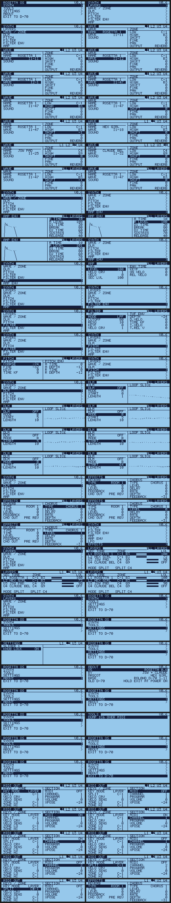
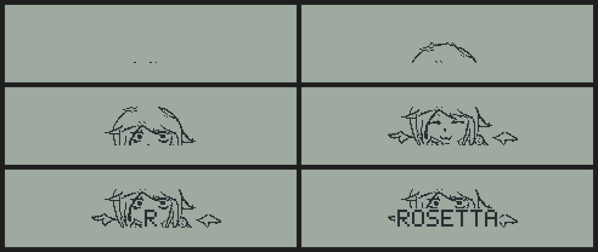
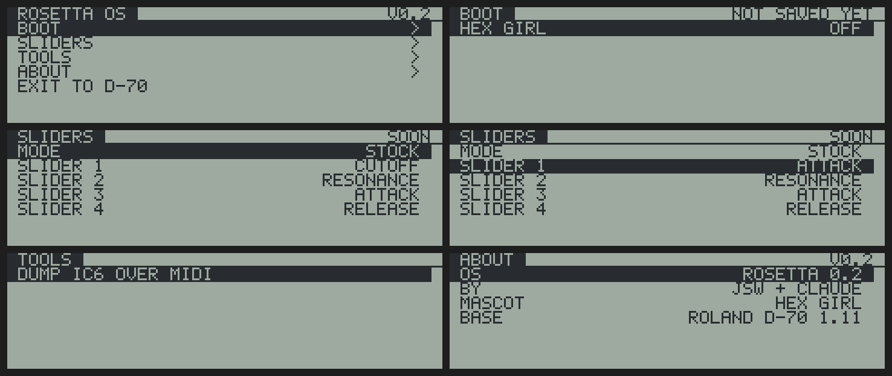

# Roland D-70 Rosetta OS  (work in progress)

<a href="https://discord.gg/xcuYZtmeyZ"><b>Join the Discord</b></a>

A new OS for the **Roland D-70** (1990 Super LA synthesizer), built one piece at a time. Today it patches Roland's
own v1.11 firmware: **Hex girl**, the Rosetta mascot, boots on the 240 x 64 LCD, the D-70 starts straight into the
**ROSETTA OS** menu, and its **SYNTH** pages edit the four layers live (wave, zone, pitch, filter, amp, both
envelopes with a drawn graph, a **DLM** page that draws the loop slice, effects, MIDI OUT) while you play. There's
an **arpeggiator**, the Alpha Dial and the sliders work in every menu, and slider 1 can grab any parameter and keep
it (**knob lock**). Stock's tone, rhythm, effects, MIDI and data-transfer screens are cut to make room: their buttons
and menu numbers land in Rosetta pages instead. **The goal is to replace the stock OS completely**: Roland's patch
and layer structure out, our own engine, menus and live controls in.

It's the same Rosetta boot as the [SP-808 Rosetta OS](https://github.com/yuyoi/Sp-808-rosetta-looper-OS-) and the
[Sony HR-GP5 Rosetta OS](https://github.com/yuyoi/Sony-HR-GP5-Rosetta-OS), now on a Roland synth.

> **Work in progress.** v0.6 is burned and running on a real D-70; the newest parts (arpeggiator fix, MIDI OUT page,
> EFFECT / MIDI OUT buttons, knob lock, the screen cut) are checked in the simulator and MAME and are being tested on
> the unit now. Keep your original EPROMs.

> **Made by JunkSmithWizard (JSW) together with Claude (Anthropic's AI).** Claude did the reverse engineering
> (80C196 disassembly, bank and LCD mapping, panel scan, the parameter system, slider and ROM PLAY code) and wrote
> the tools, the player, both menus and the simulator. JSW repaired the unit (new PCM56P DAC, 4052, a wave-ROM
> address line), dumped the EPROMs, drew Hex girl, designed the menus, decided what goes and what stays, and burns
> and tests on the real D-70.

**Legal:** this repo contains no Roland code or ROM data. You dump **your own** unit's EPROMs and the tools patch
them on your PC. Don't share dumps or builds: share this repo instead.

## Previews

Rendered from the build checker, which runs the real ROM code against a model of the D-70's LCD (the real unit
uses the LCD's own font; the previews use a stand-in, and the tone names are made up).

## Status

| What | Status |
|---|---|
| Hex girl boot animation (45 frames, 5.6 s), drawn at 2x on the big screen | **works on hardware** |
| Boots into **ROSETTA OS**: SYNTH, TOOLS, ABOUT, EXIT TO D-70. [USER] opens it again from the stock OS. Hold **[EXIT]** at power-on for the plain D-70 | **works on hardware** (v0.5) |
| **SYNTH** pages: LAYERS (tone, zone bar, level per layer, key mode), WAVE / ZONE, PITCH, FILTER, FILTER ENV, AMP, AMP ENV, LFO. Two-column pages, envelope pages draw the curve. F5 / L1-U4 pick the layer, F5 also gives ALL LAYERS (one edit writes all four) | **works on hardware** (v0.5), more pages to come |
| **DLM** page (Differential Loop Modulation: DLM on/off, mode A/B, start, length) with a live view of the loop slice read from wave ROM | **works on hardware** (v0.6) |
| **WAVE** sweep through every wave (internal + card) with its name; **EFFECTS** page (reverb, chorus) reloads the effects chip | built, sim + MAME checked |
| **ARP**: up, down, up-down, random over 1-4 octaves, tempo, hold; notes go out like real keys (all layers, effects, MIDI OUT) | built, MAME checked, on-unit test next |
| **MIDI OUT** page: key mode, split, velocity curve / sens, per section MIDI on, channel, program, volume, transpose, zone | built, sim checked |
| **Alpha Dial** in every menu (turn faster = bigger steps), **sliders** keep working in the menu | built, sim checked |
| **Knob lock** (SETTINGS): slider 1 grabs the parameter you're on and keeps driving it after you leave the menu | built, sim checked |
| [EFFECT/CTRL] and [MIDI OUT] open the Rosetta pages; stock tone / rhythm / effector / MIDI / D.Xfer screens are cut (4 KB) and their menu numbers open Rosetta instead | built, sim + MAME checked |
| Edits go through Roland's own SysEx parameter code: every value is checked, clamped and applied like an incoming SysEx message | works on hardware |
| **Boot menu** (hold [EDIT] at power-on): BOOT, SLIDERS, TOOLS, ABOUT | works on hardware |
| **Common sliders**: LOWER 1 = CUTOFF, LOWER 2 = RESONANCE, UPPER 3 = ATTACK, UPPER 4 = RELEASE, each on all four layers | **works on hardware** |
| **TOOLS > DUMP IC6 OVER MIDI**: battery RAM out as SysEx, `tools/ic6_decode.py` turns it back into a file | built, decode is byte-exact in the sim |
| ROM PLAY demo removed: **6.3 KB** of page 7 free (now holds the sliders and the SYNTH menu) | built |
| Settings saved in battery RAM | waits for an IC6 dump from a real unit |
| **TOOLS > DSP PEEK**: reads the effects chip (IC23) live, peak bits / hex per cell | **works on hardware** (v0.7) |
| **DSP LAB**: read / write the effects chip over MIDI SysEx from a PC (`dsp/dsplab.py`) | **works on hardware** (v0.8) |
| **FX box** (master insert on the effects chip): drive, bit crush, resonant LP/BP/HP filter, decimator, rectifier. Every part goes through it, whatever its Output Assign ([docs/DSP.md](docs/DSP.md)) | **works on hardware** from the PC (`dsp/fxbox.py`); FX page on the D-70 next |
| Firmware map: banks, LCD, keys, sliders, parameters, free space ([docs/FINDINGS.md](docs/FINDINGS.md)) | first pass |

## Roadmap

1. **Patch the stock OS**: boot, menus, live synth pages, common sliders, ARP, MIDI OUT, knob lock.
2. **Gut it** (now): first cut done (stock tone, rhythm, effector, MIDI and data-transfer screens). Next: free the
   code behind them, then **ARP step-pattern recording** and **wave sequencing** (a new wave every step), a
   Rosetta-style data transfer page, a new boot animation drawn for the full 240 x 64 screen. Keep the drivers:
   LCD, panel, MIDI, PCM card slots, sound chip, filter, effects.
3. **Replace it**: our own voice engine on Roland's sound chips, every button a live synth parameter, Rosetta
   menus everywhere, animations on the big screen. Ideas on the list: a real wave view, on-board PCM editing.

## How it works

- **CPU:** Intel 80C196KB at 12 MHz, firmware in two 27C512 EPROMs (IC4 even bytes, IC9 odd bytes, 128 KB).
  The CPU sees 64 KB: fixed ROM, a 16 KB window that shows one of eight ROM pages or the battery RAM, and work RAM.
  The stock firmware keeps **page 2** in the window and calls into it directly, so all our page-7 code calls stock
  routines through Roland's own far-call stubs (bank in, call, bank back).
- **LCD:** T6963C, 240 x 64, 6 pixels per byte, text and graphics layers XORed together. Stock uses two text pages
  (0x1400, 0x1540) and two graphics pages; the menu draws its text at 0x1680 and flips the LCD's home addresses,
  so the stock screen keeps updating underneath and comes straight back on EXIT.
- **The boot:** 3 bytes at the start of the normal boot path call a 680-byte player in free space. It parks a
  bit of work RAM in unused LCD memory, plays the frames straight to the LCD (timed on the CPU's own timer, 50 ms
  steps), then puts everything back exactly as it found it. Then the stock boot carries on.
- **The codec** (`tools/codec_d70.py`) codes each frame as changes against the previous one (skips, fills, copies
  from ahead, XOR bytes, replays). Hex girl's 45 frames go from 115 KB raw to 2.3 KB.
- **ROSETTA OS menu:** 3 bytes in the main loop swap Roland's UI step for ours (via a 7-byte trampoline into
  page 7). Menu closed: Roland's UI runs as before. Menu open: our key handling and drawing run instead, while MIDI,
  sound and the sliders keep going. Parameters are read and written through the firmware's SysEx address table.
- **Common sliders:** 3 bytes jump over Roland's play-mode slider loop. In four-layer mode each moved slider goes
  to its own parameter on all four layers; every other mode runs Roland's code untouched. The menu runs that loop
  itself, so the sliders keep working while it's open.
- **ARP:** keyboard events come off the interrupt ring through one far-call entry; 3 bytes point it at the ARP,
  which keeps the held chord and sends notes back into the same queue a real key uses, timed on the CPU's timer.
- **Alpha Dial:** the panel board counts the clicks itself; one stock routine reads the count (signed) over the
  panel's serial port, and the menu reads it every pass.
- **The cut:** every stock screen has a step routine, an enter routine and a display list. Cut screens get the
  play screen's routines, their display lists (4 KB on page 4) are wiped, and any stock path into one lands in
  the matching Rosetta page.
- **Every build is checked** before it's written: `tools/sim.py` runs the real ROM bytes (decoded by our own
  80C196 disassembler) against an LCD model and compares every frame, drives both menus through key tours, checks
  every parameter write, decodes the IC6 dump back, exercises the slider hook, and fails on anything the real CPU
  would get wrong (word reads at odd addresses, stock code called with the wrong ROM page in the window).

## Quick start

**Easiest: Rosetta Patcher (Windows).** Download `RosettaPatcher-D70.exe` from the
[Releases](https://github.com/yuyoi/D70-Rosetta-Os/releases) page and run it: no Python needed. Or, with Python 3
(`pip install numpy pillow`), double-click `tools/Rosetta_Patcher.bat` (or run `python tools/rosetta_patcher.py`).
Pick your IC4 and IC9 dumps (either order: it sorts them out) or one combined 128 KB file, and an output folder.
It checks that they are v1.11, runs the whole build with every check (a few minutes) and writes the two images to
burn. Command line: `python -I tools/rosetta_patcher.py --even IC4.bin --odd IC9.bin --out outdir`
(or `--both combined.bin`).

By hand:

1. **Dump your EPROMs.** IC4 is the even one, IC9 the odd one. With a T48:
   `minipro -p "AM27C512@DIP28" -r dumps/IC4_even.bin` (and IC9). Read each twice and compare.
   The tools expect firmware **v1.11** (IC4 MD5 `3f9e12e8d73380a5c26c312940f1ff6e`,
   IC9 MD5 `640e279056386577499544f826df9253`) and refuse anything else.
2. `pip install pillow numpy`
3. `python -I tools/boot_build.py dumps/IC4_even.bin dumps/IC9_odd.bin` (a few minutes, most of it the checks)
4. **Burn two new chips and keep your originals.** 27C512 (we use W27C512):
   `build/D70_rosetta_v06_IC4_even.bin` goes in **IC4**, `build/D70_rosetta_v06_IC9_odd.bin` in **IC9**.
5. Power off, swap the chips (notch the same way round), power on. It boots into ROSETTA OS. Hold **[EXIT]** while
   switching on for the plain D-70, **[EDIT]** for the boot menu.

## Tools

| File | What |
|---|---|
| `tools/rosetta_patcher.py` | Rosetta Patcher: window / command line around the build (also the `.exe` in Releases) |
| `tools/boot_build.py` | builds Rosetta OS from your dump, runs every check, writes the images and previews |
| `tools/player.py` | the boot player (80C196) |
| `tools/menu.py` | the boot menu: pages, keys, drawing, the IC6 dump |
| `tools/synth.py` | ROSETTA OS / SYNTH menu: pages, parameter access, drawing, envelope graphs |
| `tools/sliders.py` | the common-slider hook |
| `tools/arp.py` | the arpeggiator: key in, clock, note out |
| `tools/cuts.py` | stock features removed and the space they free |
| `tools/codec_d70.py` | the frame codec |
| `tools/asm.py` | small 80C196 assembler; every instruction is decoded back to check it |
| `tools/mcs96.py` | 80C196 (MCS-96) disassembler |
| `tools/sim.py` | check-only 80C196 simulator with the D-70's LCD, banks and battery RAM |
| `tools/ic6_decode.py` | turns a captured IC6 dump (SysEx) into a 32 KB file |
| `tools/font57.py` | 5 x 7 preview font |
| `frames/roland_chan_frames.npz` | Hex girl boot frames (same as the SP-808 Rosetta boot) |
| `docs/FINDINGS.md` | the firmware map |
| `tools/dsplab.py` | DSP LAB: the SysEx receiver in the firmware (`tools/test_dsplab.py` checks it in the sim) |
| `dsp/` | PC tools for the effects chip: `dsplab.py`, `fxbox.py`, `hwab.py`, `hwscan.py`, `fxhw_master.py` |
| `docs/DSP.md` | effects chip findings and the FX box |

## Legal

Not affiliated with or endorsed by Roland Corporation. "Roland" and "D-70" are trademarks of Roland Corporation.
This repo contains **no Roland code or data**: you build from your own EPROM dumps. Hex girl art by JSW. Burn at
your own risk, and always keep your stock EPROMs.

License: MIT (see `LICENSE`).

---

**Thanks for enjoying, and God bless you!** — JSW
